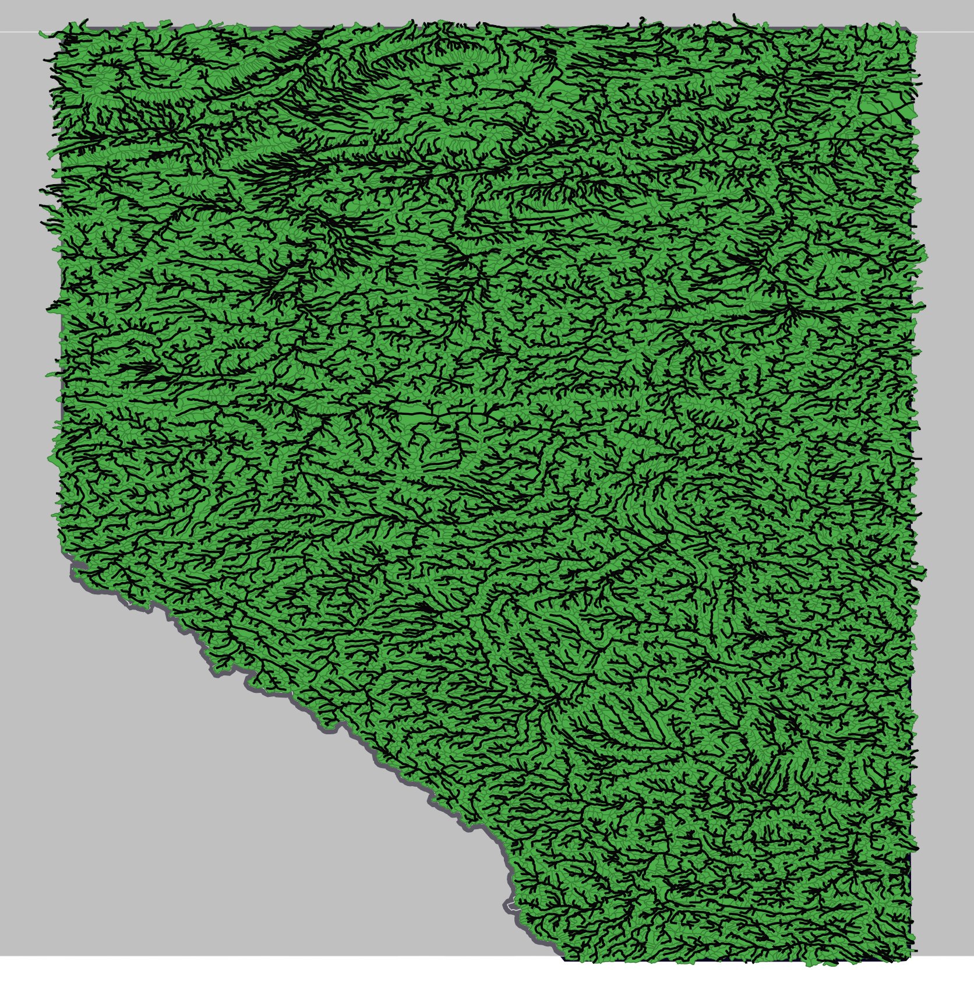

# Instantiations of MESH, SUMMA, and HYPE for Alberta
This repository contains the instantiations of three hydrological models (MESH, SUMMA, and HYPE) for the province of Alberta, Canada.

## Datasets
### Geospatial Fabric
The models are set up using the `MERIT-Basins` dataset, which
provides high-resolution hydrography and watershed boundaries.
The version used is accessed from [ReachHydro](https://www.reachhydro.org/home/params/merit-basins)
on October 9, 2025.

The version used is "MERIT_Hydro_v07_Basins_v01_bugfix1".

### Meteorological Dataset
The meteorological forcing data is sourced from the Environment
and Climate Change Canada (ECCC) `CaSRv3.1` dataset. The dataset
was last access on October 9, 2025 at [CaSRv3.1](https://hpfx.collab.science.gc.ca/~scar700/rcas-casr/).

The tool used to extract subsets from the dataset for AB is
called `datatool` and can be access at the following webpage:
[Datatool GitHub repository](https://github.com/CH-Earth/datatool.git).

The commit hash used is `4967bf9`.

### Geospatial Datasets
The tool used to extract geospatial dataset subsets and statistics
for the Alberta sub-basins is called `geotool` and can be access
at the following webpage: [GISTool GitHub repository](https://github.com/CH-Earth/gistool.git).

The commit hash used is `0391642`.

#### Landcover Dataset
The landcover dataset used is `MODIS MCD12Q1.061`. The version used
is accessed from [LP DAAC](https://lpdaac.usgs.gov/products/mcd12q1v061/) on
October 9, 2025. The year used is 2020.

#### Soil Dataset
The soil dataset used is `Global USDA-NRCS soil texture class map`
derived from `Soil Grid v1 (2017)`. The version used is accessed from
[Hydroshare](https://www.hydroshare.org/resource/1361509511e44adfba814f6950c6e742/).

The relevant DOI is: 10.4211/hs.1361509511e44adfba814f6950c6e742.

#### Elevation Dataset
The elevation dataset used is `MERIT-Hydro DEM v1.0`. The version used
is accessed from [MERIT-Hydro webpage](https://hydro.iis.u-tokyo.ac.jp/~yamadai/MERIT_Hydro/)
on October 9, 2025.

The relevant DOI is: 10.1029/2019WR024873.

## Model-Specific Workflows

### MESHFlow
The MESHFlow workflow is used to generate MESH instantiation 
for the Alberta domain. The workflow is located in the following:
[MESHFlow](https://github.com/CH-Earth/meshflow.git).

The commit hash used is: `e68a01c`.

### SUMMAFlow
The SUMMAFlow workflow is used to generate SUMMA instantiation
for the Alberta domain. The workflow is located in the following:
[SUMMAFlow](https://github.com/kasra-keshavarz/summa-model-specific.git).

The commit hash used is `aaf183f`.

### HYPEFlow
The HYPEFlow workflow is used to generate HYPE instantiation
for the Alberta domain. The workflow is located in the following:
[HYPEFlow](https://github.com/CH-Earth/hypeFlow.git).

The Pull Request used is `#1`. The commit hash used is `1f41a14`.

# Model-agnostic
`Agnostic` part of the modelling effort is located in the following:
[agnostic](./1-model-agnostic). Processing, however, is summarized
in the [orchestration](3-orchestrator) section.

# Model-specific
`Specific` part of the modelling effort is located in the following:
[specific](./2-model-specific).

Last updated: October 2025

